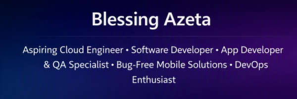
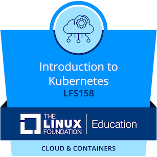
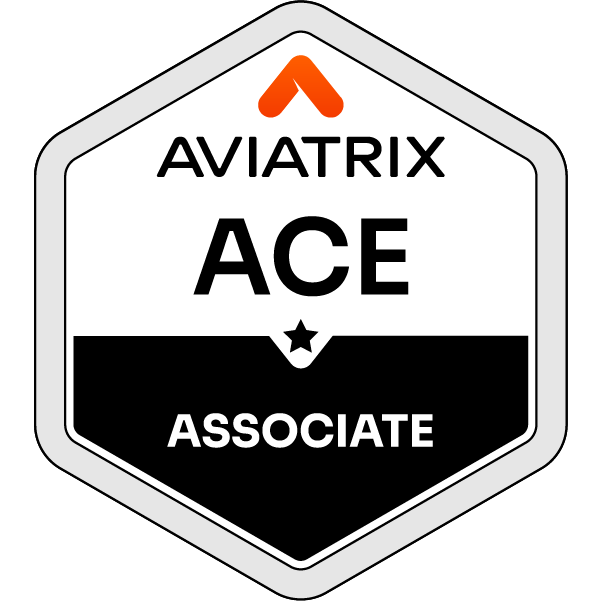
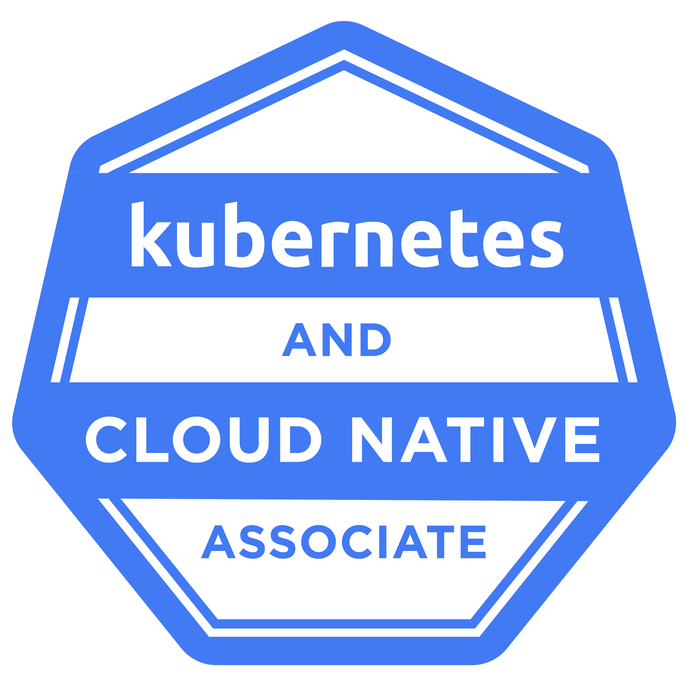
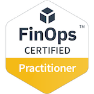

<h1 align="center">
  

---

### 💬 About Me
- 🌱 **Cloud, DevOps & DevSecOps Engineer** specializing in secure containerization, infrastructure-as-code, automated CI/CD pipelines, and cloud cost governance.
- 📈 Currently pursuing an **M.Sc. in Financial Engineering** (Expected Dec 2027), bridging cloud infrastructure with quantitative risk modeling.
- 🚀 Working on production-grade systems including **QuantGuard** (Parametric VaR & FinOps Engine), **Executive-Chief-of-Staff** (Azure AI Briefing Platform), and **Wealth Habits**.
- 📍 Seeking roles in Cloud Architecture, FinOps, and DevSecOps.
- 📫 Reach me at **azetablessingb@gmail.com** or connect with me below!

---

### 🤝 Connect with Me

  
  
  

---

### 🚀 Technical Stack & Tooling

---

### 🌟 Featured Cloud & DevSecOps Projects

* **[QuantGuard-API](https://github.com/Azeta-Insights/quant-guard-api)** — Cloud-native Parametric Value at Risk (VaR) microservice. Features automated DevSecOps Trivy vulnerability gating in GitHub Actions, least-privilege non-root Docker hardening, and Terraform-provisioned Azure Container Apps with scale-to-zero FinOps cost governance.
* **[Executive-Chief-of-Staff](https://github.com/Azeta-Insights/Executive-Chief-of-Staff)** — AI-powered executive briefing platform deployed on Azure Container Apps with automated DevSecOps pipelines and Cloudflare Worker proxy integration.
* **[Blaze Store](https://github.com/Azeta-Insights/Blaze_Store)** — Cloud-native Express and React e-commerce application integrated with Firebase Firestore and Paystack payment gateway verification.

---

### 🏅 Certifications
| Certification | Issuing Organization | Date |
|---------------|----------------------|------|
| Microsoft Azure Fundamentals (AZ-900) | Microsoft | Jan 2026 |
| AWS Cloud Practitioner | AWS | Feb 2026 |
| Kubernetes and Cloud Native Associate (KCNA) | CNCF | Apr 2026 |
| Introduction to Kubernetes (LFS158) | Linux Foundation | May 2026 |
| Aviatrix Certified Engineer (ACE Associate) | Aviatrix | Jun 2026 |
| Foundations of Financial Engineering | WorldQuant University | Nov 2025 |
| FinOps Certified Practitioner | FinOps Foundation | May 2026 |
| DevSecOps Essentials (DISE) | EC-Council | Apr 2026 |

---

### 🎯 Badges

---

---

---

---

⭐ Thank you for visiting my profile! ⭐

